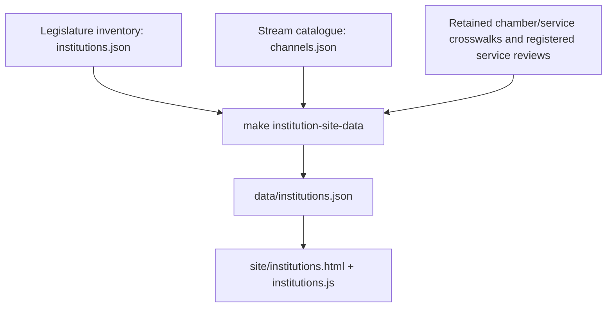

# Architecture

This repository maintains legislative-institution records, official viewing
sources and their evidence, and publishes them as a static website.
The [naming guide](naming-conventions.md) defines the domain vocabulary and the
compatibility names retained in data, code and commands.

## Two Canonical Lists

| List | Canonical file | Public view | A record means |
| --- | --- | --- | --- |
| Legislature inventory | [data/discovery/institutions.json](../data/discovery/institutions.json) | [Legislatures](../site/institutions.html) | An institution or retained research identity with its authority decision, relationships, provenance and unresolved questions. |
| Stream catalogue | [data/channels.json](../data/channels.json) | [Catalogue](../site/index.html), coverage map and schedule links | A reviewed viewing source with a documented technical and permission posture. It can be an official page, archive, channel or direct stream. |

Inventory entries include eligible legislatures, specific authority holds,
exclusions and historical predecessors. Records have different grains, including
umbrella legislatures and individual chambers. Their total is not a count of
usable streams. One institution may have several catalogue sources; inventory
membership alone does not publish one.

`data/channels.json` is the canonical published catalogue. Every catalogue source record
contains:

- institutional identity links, usually Wikidata and IPU Parline where
  applicable;
- source type and playback posture;
- official URL and provenance notes;
- compact links to retained validation reports when available;
- accessibility evidence;
- schedule/EPG source metadata; and
- permission evidence and a reuse recommendation.

`schema/channels.schema.json` defines the public JSON shape. Python validation
adds cross-record rules that JSON Schema cannot express, such as source-type and
technical-status coherence.

Eligibility follows [catalogue scope](catalogue-scope.md): substantive
legislative authority, not the presence of a council webcast. The wider
country/territory evidence supports the decisions recorded in the inventory.
Historical discovery totals are not public-catalogue totals.

## Supporting Inputs And Review Decisions

The [data directory guide](../data/README.md) identifies maintained inputs,
decision ledgers and generated files. Discovery data has separate roles:

- `data/discovery/tier1.json` and `tier2.json` maintain research priorities and
  seed routes. The monthly discovery plan combines these with all maintained
  eligible identities, registered service evidence and current catalogue sources;
- [service-review-inputs.json](../data/discovery/service-review-inputs.json)
  explicitly lists the dated individual service reports consumed by inventory
  projections, service baselines and discovery planning. Its versioned `reports`
  array contains unique repository-relative JSON paths. An unlisted report stays
  retained evidence; its filename does not opt it into maintenance;
- `data/discovery/inventory-review-decisions.json` records human dispositions of
  automated inventory findings. Accepting a finding still requires a separate
  source-backed inventory edit;
- `data/discovery/reviewed-manifests.json` retains evidence-backed dispositions
  so rejected manifest findings do not repeatedly reopen review work;
- `data/discovery/reviewed-page-leads.json` separately retains dispositions of
  observed viewing, archive, recording, channel and programme-page leads, using
  the same dated decision fields; and
- `data/discovery/us-legislatures.json` records six federal candidates and all
  50 state legislatures for manual U.S. expansion research. Its
  `verified_official_video_surface` status confirms an official video surface,
  not a stable channel, playback permission, or catalogue readiness.

`data/fallbacks.json` maintains supplemental official event platforms and player
pages with conservative playback claims. `data/supranational.json` maintains
membership and participation context for international sources on the map.
These support the catalogue without becoming another institution inventory.

Some retained reports remain maintenance inputs: the national chamber directory,
the historical service crosswalk and explicitly registered individual reviews.
Health reports also feed compact validation-history references. Preserve their
paths and provenance when maintaining them. The [reports guide](../reports/README.md)
distinguishes these roles from generated workflow observations.

## Generated And Local Files

`npm ci` prepares the ignored browser libraries and license notices in
`site/assets/vendor/` from `package-lock.json`. HLS.js uses its full upstream
distribution; D3 is bundled from the installed modules so transitive dependency
updates affect the browser asset. CI and every Pages deployment run this step.
The browser loads same-origin libraries using generated content hashes for
cache keys. See `site/assets/vendor/README.md` for the maintenance workflow.

Pages assembly also runs `tools/version_site_assets.mjs` to fingerprint HTML
references to site JavaScript and CSS. Dynamically fetched map geometry has
explicit URL versions. Publication pins the triggering SHA and requires the
latest trusted CI and CodeQL runs to succeed for that exact current `main`
revision, with another gate immediately before deployment. Scheduled runs do not
fall back to an older passing revision. [Public-site behaviour](public-site.md) covers caching,
map/search relationships, deployment and localization.

Browser code loads JSON through `site/data-loader.js`, which shares requests across
page changes. Catalogue records live only in `data/channels.json`; no executable
JavaScript copy is generated. Hosted pages read their own deployment's JSON.
Direct-file previews fetch the published JSON from GitHub Pages over HTTPS.

The Legislatures page has its own generation path:

The builder projects the full maintained inventory into a compact JSON
product, joining exact catalogue IDs and dated evidence. It preserves exclusions,
holds and historical records; the public page applies status, country and search
filters. Its default view is a subset of the retained records. A country's or
parent legislature's viewing source is never automatically copied to a chamber.
`make institution-site-data-check` detects drift; edit the inputs and regenerate
the JSON projection instead of editing it directly.

`data/schedules.json` is a local generated now/next snapshot and is ignored by
Git. GitHub Pages generates its own schedule snapshot during deployment.

After collection, `iptv-export` generates two extended-M3U HLS channel lists
and an XMLTV guide in the Pages artifact. `schedule_quality.py` applies an
explicit source-to-feed allowlist, rejects conflicting or invalid time ranges,
and supplies the same decisions to the XMLTV writer and `epg-quality.json`.
Parallel event directories, including European Parliament, remain website
metadata rather than one fictional linear channel. The strict list selects lower-risk,
validated, native-playback, always-on HLS; the broader list also includes
sitting-dependent feeds. XMLTV exports complete start/end timestamps without
adding durations in the exporter, with channel IDs shared by catalogue and
playlists. Parser-level inferred ends and assumed dates carry explicit
provenance and are disclosed in XMLTV descriptions. Daily audits also retain
the quality report without failing the entire collection for partial coverage.

`make validation-history` summarizes retained per-channel health checks back into
`data/channels.json`; `make validation-history-check` verifies that those compact
references have not drifted. The browser reads the published summaries rather
than scanning the report directories.

## Code Boundaries

`parliament_streams/` contains reusable validation, catalogue, discovery,
schedule and export logic. Its `inventory/` package separates directory/source
adapters (`sources.py`), registered service evidence (`reviews.py`) and exact
identity/projection logic (`projection.py`). `research_evidence.py` supplies shared
evidence sanitization. Schedule adapters live in the explicit `scrapers/` registry.

`tools/` provides repository-maintenance commands, renderers, browser checks and
asset assembly. For example, `tools/build_institution_site_data.py` renders the
inventory projection into public JSON; the monitor and service-baseline
builder reuse the package's projection logic. The Makefile and workflow commands
remain stable entry points. [Development](development.md) covers setup and checks.

## Runtime Shape

The public site is static:

1. GitHub Pages serves the assembled static publication artifact.
2. Catalogue, map and schedule surfaces load the published catalogue data;
   the Legislatures page loads `data/institutions.json`.
3. Schedule-aware pages optionally fetch the freshly published `data/schedules.json`.
4. Catalogue surfaces fetch `data/fallbacks.json` for related fallback links and the fallback
   directory.
5. It renders catalogue rows, source details, latest retained validation
   evidence, rights notes, and official links.
6. It enables native playback only when catalogue metadata permits it.
7. `site/navigation.js` progressively replaces the main/header/footer of the five
   ordinary HTML pages while a shared viewer remains attached to the document.
   `site/app.js` rebinds catalogue controls when returning; other page controllers
   initialize for their current route and use an abortable page lifecycle for
   global listeners, observers and pending initialization. The desktop move/resize
   controls are isolated in `site/viewer-controls.js`.

The shared viewer keeps the actual native video/provider iframe and HLS instance
across internal navigation and translation. It does not save a playback timestamp
and start a new player. Source selection and Close retain explicit teardown;
filtering, sorting, resizing, minimising and changing page do not tear down media.
The mobile sheet uses the same viewer DOM with the existing responsive controls.
Source URLs, page URLs and programme data keep their existing separate contracts.

There is no server-side proxy, transcoder, database, account system, analytics
pipeline, or request-time scraper.

## Source Types

`source_type` is a coarse UI and compatibility category:

- `direct_hls`: a recorded HLS URL discovered from an official or official-vendor
  surface.
- `direct_dash`: a recorded DASH URL kept for provenance or review.
- `youtube`: an official YouTube source rendered through YouTube's
  privacy-enhanced embed path.
- `official_page`: a link-out source where native playback is not appropriate,
  not validated, or not permitted.

`source_kind` is the more precise provenance and delivery classification:

- `first_party_hls`: HLS served from the legislature, parliament, or closely
  controlled institutional domain.
- `official_vendor_hls`: HLS served by a CDN, streaming contractor, or platform
  clearly used by the official source.
- `third_party_relay_hls`: HLS served by a relay that is not clearly operated or
  authorized by the source. These should normally stay out of playback.
- `direct_dash_research`: DASH endpoint retained as research evidence, not as
  a playback route supported by the current browser player.
- `official_youtube_embed`: official YouTube presence rendered through the
  provider's embed path without extracting manifests.
- `official_page`: official link-out/player page with no native playback claim.

`stability_risk` is operational rather than legal. It records whether a URL or
player route appears low, medium, high, or unknown risk for drift, event-only
failure, or needing manual review. It does not grant permission to replay a
source.

`technical_status: link_only` must pair with `source_type: official_page`.
Browser-discovered playback URLs should not be promoted to direct playback until
their stability, provenance, and reuse posture are documented.

Fallback sources use a separate model. They can describe official event pages,
official player pages, official broadcaster pages, and provider-managed embeds.
Their `playback_claim` must stay conservative: a fallback can document link-out
or provider-managed playback without asserting that a reusable direct stream
exists. The current site renders related fallbacks in the source detail panel
while standalone records remain available only in the published JSON dataset.

## Maintenance Flow

Prefer candidate records for new sources:

1. Create a candidate with `parliament-streams candidate-new`.
2. Add official provenance, identity, accessibility, schedule, and permission
   evidence.
3. Validate the candidate.
4. Mark it `ready`.
5. Promote it with `candidate-promote`.

Promotion validates the full catalogue, updates `generated_on`, writes the
catalogue JSON, and records the candidate outcome. Bulk manual edits are possible
for reviewed maintenance, but they should be followed immediately by
`make site-data` and `make verify`.

## Scrapers And Schedules

Schedule parsers live in `parliament_streams/scrapers/`. Parsers should consume
saved JSON, XML, ICS or retained machine-readable HTML and return normalized
schedule data. Prefer supported structured feeds; the source-selection policy
and documented hybrid exception are in [schedules and IPTV](schedules-and-iptv.md#source-selection). They should not
perform network requests directly; `parliament_streams/schedule_collection.py`
owns HTTP, retries, timestamps, errors, and output shape.

Use `scraper_status: implemented` only when the parser is registered and tested.
Use `scraper: planned` with `scraper_status: planned` for useful official
schedule surfaces that still need implementation.

The programme guide renders collected events. A separate compact disclosure
links to planned human-readable calendar/event sources without adding fictional
guide rows. [Schedules and IPTV](schedules-and-iptv.md) documents collection,
staleness, XMLTV exclusions and playlist eligibility.

## Validation Stack

`make verify` is the high-confidence local check. It runs JSON parsing,
catalogue and fallback validation, candidate, democracy-discovery, and U.S.
inventory validation, generated-site drift checks, Ruff formatting and
linting, strict mypy, Python
compilation, unit tests with coverage, HTML validation, and Playwright/Axe
accessibility checks.

Daily and monthly GitHub Actions workflows repeat catalogue audits, link checks,
health checks, schedule audits, and static/rendered-page candidate discovery.
After structure validation, independent daily probes continue after another
probe or issue API failure, while failures remain visible. Recovery alerts
require a current `ok` result. Discovery distinguishes format-checked manifests
from unverified page leads; observed links do not establish media playback or
rights. Automated reports do not change either canonical list or promote sources.
See [GitHub Actions and review queues](github-actions.md) for cadences, caps,
review ledgers and the deployment gate.
Stable-stream regression checks use `availability` and `stability_risk` to keep
alerts focused: high-risk sources remain in the full health report, but do not
drive the low-noise always-on regression issue workflow.

## Where To Start

- To understand the published data model: read `schema/channels.schema.json`
  and `schema/fallbacks.schema.json`, then `parliament_streams/models.py`.
- To understand the institution pipeline: start with the
  [inventory guide](../data/discovery/README.md) and
  `parliament_streams/inventory/projection.py`.
- To understand discovery watchlists: read
  `schema/discovery-targets.schema.json` and
  `schema/us-legislature-candidates.schema.json`.
- To add or change a source: read `docs/catalogue-maintenance.md`.
- To understand source rights posture: read
  `docs/source-rights-and-permissions.md`.
- To work on the static site: start with `site/app.js`, then run
  `npm run check:site`.
- To work on schedule metadata: start with
  `parliament_streams/schedule_collection.py` and one existing scraper.
